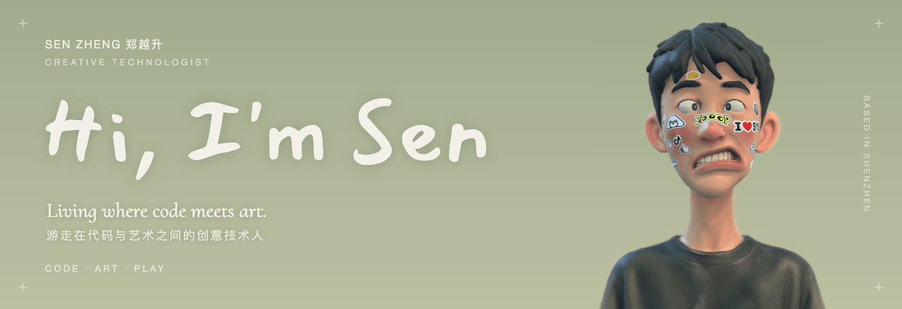
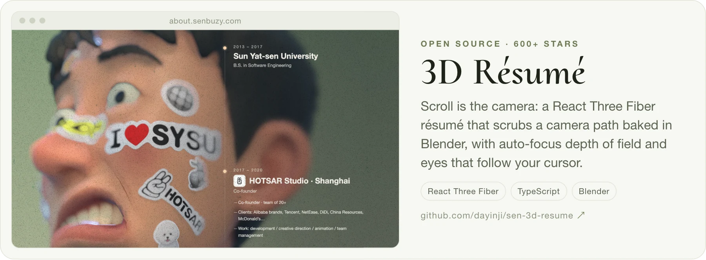
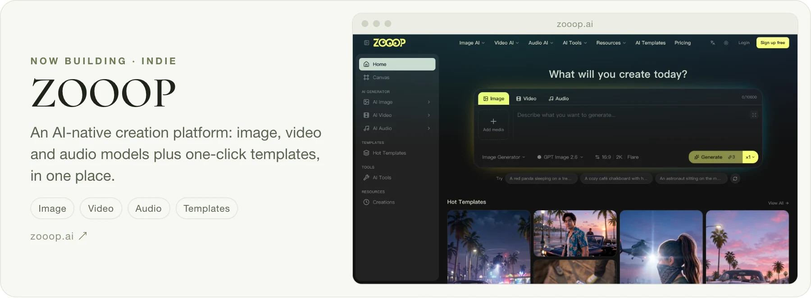
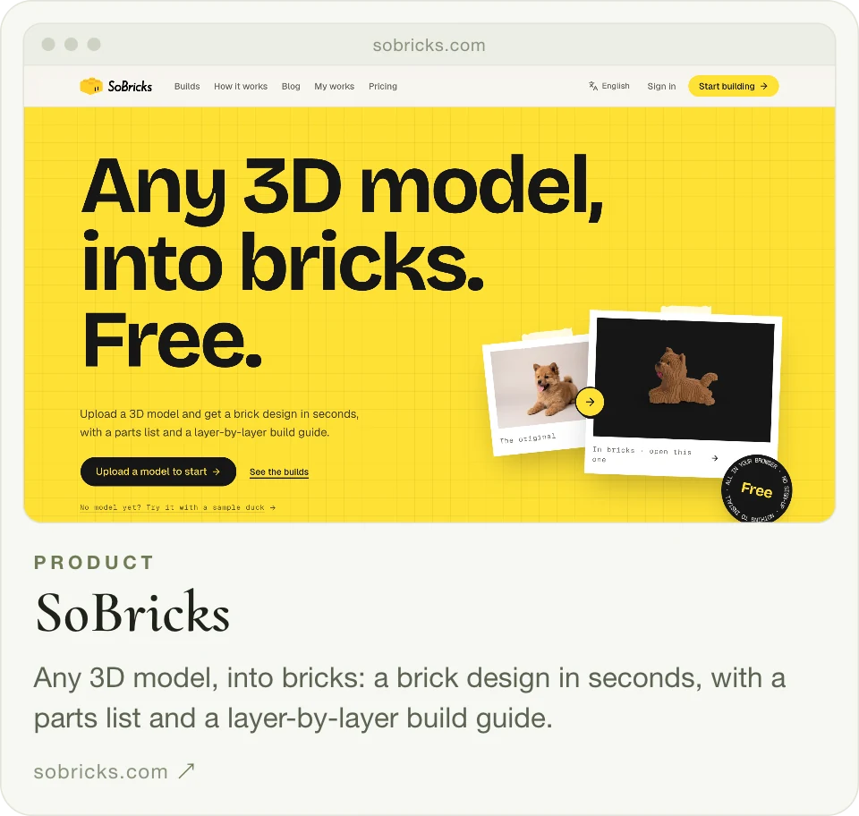
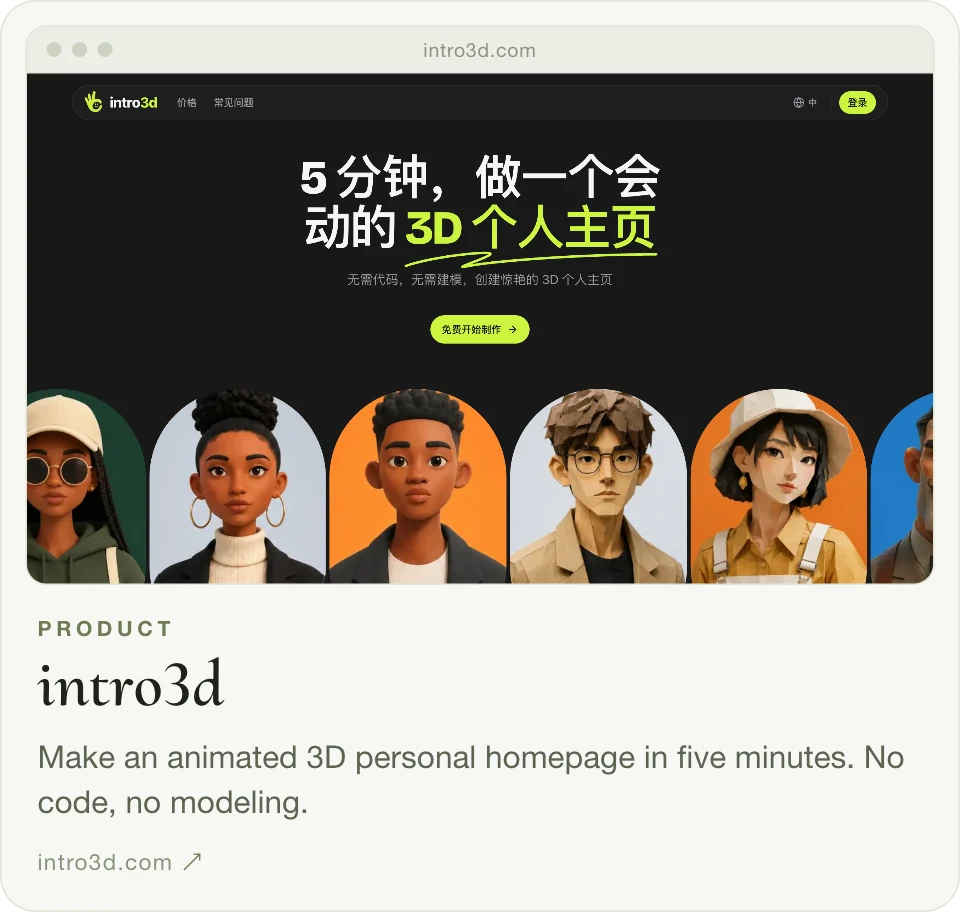
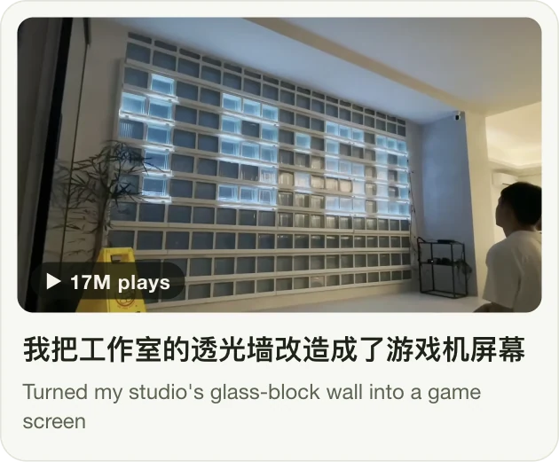
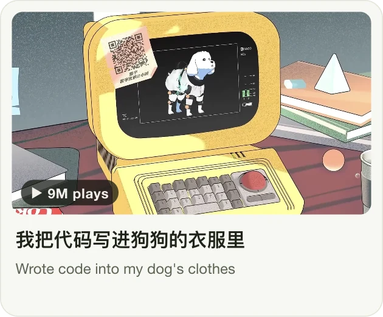
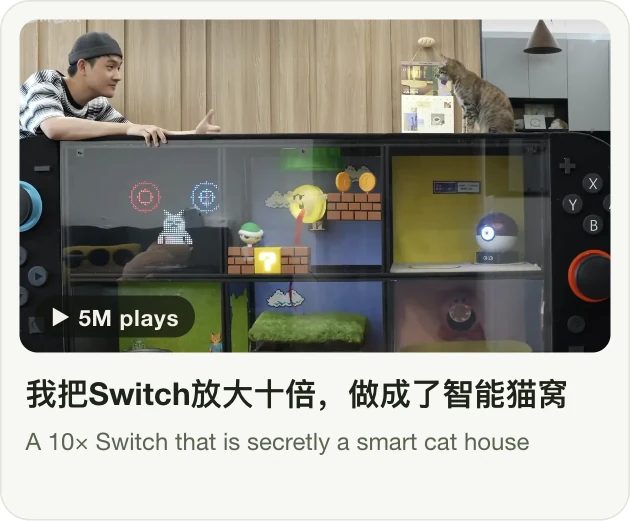

  

  
  
  
  

I'm **Sen Zheng (郑越升)**, a creative technologist based in Shenzhen. I work where code meets art: interactive campaigns, animation, CG and tech-DIY builds. I like combining skills from different fields to see what new things come out of them.

### Things I'm building

<a href="https://github.com/dayinji/sen-3d-resume">
  <picture>
    <source media="(prefers-color-scheme: dark)" srcset="assets/card-resume-dark.webp">
    
  </picture>
</a>

<a href="https://zooop.ai">
  <picture>
    <source media="(prefers-color-scheme: dark)" srcset="assets/card-zooop-dark.webp">
    
  </picture>
</a>

  <a href="https://sobricks.com"><picture><source media="(prefers-color-scheme: dark)" srcset="assets/card-sobricks-dark.webp"></picture></a>
  <a href="https://intro3d.com"><picture><source media="(prefers-color-scheme: dark)" srcset="assets/card-intro3d-dark.webp"></picture></a>

### Things I've made for the internet

Tech-DIY videos where one person does the 3D modeling, 3D printing, PCB design, embedded code, software and motion graphics.

  <a href="https://www.bilibili.com/video/BV1PZ4y1v7Gj"><picture><source media="(prefers-color-scheme: dark)" srcset="assets/video-glass-dark.webp"></picture></a>
  <a href="https://www.bilibili.com/video/BV1s84y1q7xi"><picture><source media="(prefers-color-scheme: dark)" srcset="assets/video-dog-dark.webp"></picture></a>
  <a href="https://www.bilibili.com/video/BV1vMhHzLELM"><picture><source media="(prefers-color-scheme: dark)" srcset="assets/video-switch-dark.webp"></picture></a>

### Toolbox

<picture>
  <source media="(prefers-color-scheme: dark)" srcset="assets/toolbox-dark.svg">
  
</picture>

  

CODE · ART · PLAY &nbsp;—&nbsp; <a href="https://senbuzy.com">senbuzy.com</a>

